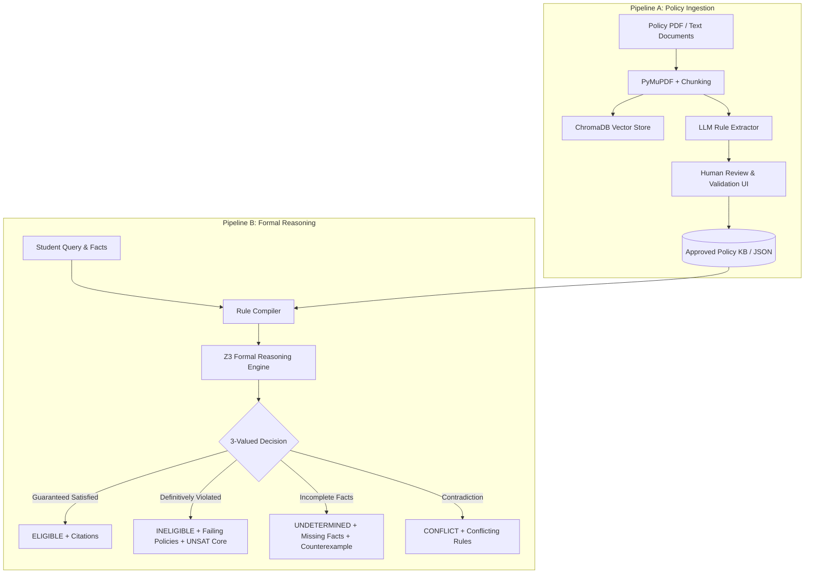

# Counterexample-Guided Academic Policy Reasoning with LLMs, RAG, and Z3

A machine reasoning system that formalizes university academic policy regulations, verifies student registration eligibility using the **Z3 SMT Solver**, detects policy contradictions via **UNSAT Cores**, generates **counterexamples**, and grounds explanations in verifiable source passages.

---

## Architecture Overview



---

## Project Structure

```
academic-policy-reasoner/
├── README.md
├── requirements.txt
├── demo.py                        # Interactive query demo
├── data/
│   ├── raw_policies/
│   │   └── academic_policy_nitech.txt  # 25 ground-truth university policies
│   ├── policies.json              # Structured rules with source tracking
│   ├── students.json              # 15 diverse student profiles
│   └── test_cases.json            # 15 ground-truth evaluation benchmarks
├── reasoning/
│   ├── __init__.py
│   ├── rule_schema.py             # Pydantic models for rules, students, test cases
│   ├── rule_compiler.py           # AST translator to Z3 variables & constraints
│   ├── z3_engine.py               # 3-valued formal solver & explanation generator
│   ├── counterexample.py          # Counterexample search (Phase 4)
│   └── conflict_detector.py       # UNSAT-core contradiction finder (Phase 4)
├── ingestion/                     # PDF extraction and passage chunking (Phase 3)
├── retrieval/                     # ChromaDB & Sentence-Transformer RAG (Phase 3)
├── llm/                           # Local Ollama client & structured prompts (Phase 3)
├── services/                      # Service layer connecting UI and logic
├── tests/
│   ├── test_rules.py              # Schema, DAG & integrity test suite
│   └── test_reasoner.py           # 15/15 automated regression benchmark tests
└── evaluation/                    # Comparative ablations (Phase 6)
```

---

## 6-Phase Implementation Roadmap

1. **Phase 1: Academic Policy Dataset & Rule Schema (Completed)**
   - Created fictional Northbridge Institute of Technology (NITech) policy regulations with 25 rules (R001–R025).
   - Formalized Pydantic schemas for rules, sources, students, and test cases.
   - Built 15 benchmark student profiles and ground-truth test cases.
   - Passed 100% of schema integrity, DAG acyclicity, and cross-reference tests.

2. **Phase 2: Z3 Reasoning Engine (Core Prototype Working)**
   - Implemented `RuleCompiler` and `Z3Reasoner`.
   - Verified 3-valued logic (`ELIGIBLE`, `INELIGIBLE`, `UNDETERMINED`, `CONFLICT`).
   - Automated unsat-core rule localization for failing policies.
   - All 15 benchmark test cases pass (`pytest tests/test_reasoner.py`).

3. **Phase 3: LLM Extraction & RAG Pipeline**
   - Ingest PDF documents with PyMuPDF with page and passage tracking.
   - Store passage embeddings in ChromaDB.
   - Local Ollama prompt pipeline for structured JSON rule extraction with Pydantic validation.
   - Human-in-the-loop review interface to edit and approve extracted rules.

4. **Phase 4: Counterexample Generation & Conflict Detection**
   - Counterexample search: Disprove false LLM generalizations (e.g. "All students with GPA > 8.0 are eligible").
   - Contradictory rule detection using Z3 `unsat_core()`.
   - Missing-information reasoning and boundary exploration.

5. **Phase 5: Streamlit Web Application**
   - Screen 1: Policy Ingestion & Passage Chunk Viewer.
   - Screen 2: Rule Review & Approval Editor.
   - Screen 3: Student Information & Course Registration Query Form.
   - Screen 4: Formal Verification Results, Unsat Cores, Counterexamples, and Citations.

6. **Phase 6: Systematic Scientific Evaluation**
   - 150 student test cases across 6 difficulty categories.
   - 5-way ablation experiment:
     - Config A: Direct LLM
     - Config B: RAG + LLM
     - Config C: LLM + Z3
     - Config D: RAG + LLM + Z3
     - Config E: Reviewed Rules + Z3
   - Report precision, recall, conflict detection rate, and counterexample validity.

---

## Quickstart & Verification

### 1. Run Automated Test Suite
```bash
python -m pytest tests/
```

### 2. Test Interactive Demo
```bash
# Student with faculty waiver (Eligible)
python demo.py S003 CS301

# Student missing prerequisite (Ineligible)
python demo.py S002 CS301

# Student with missing CGPA (Undetermined)
python demo.py S013 CS301
```

